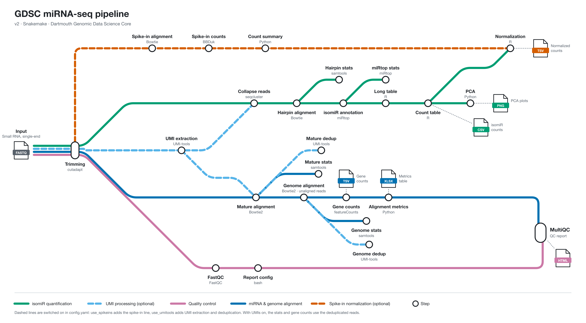
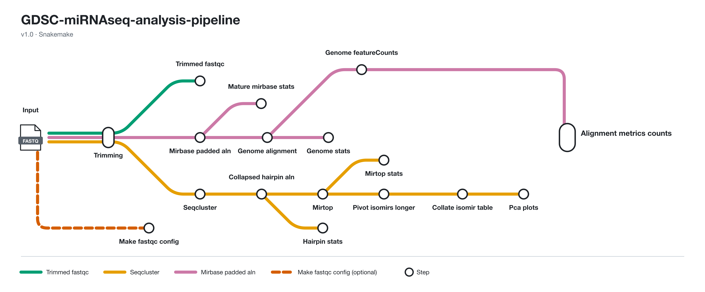
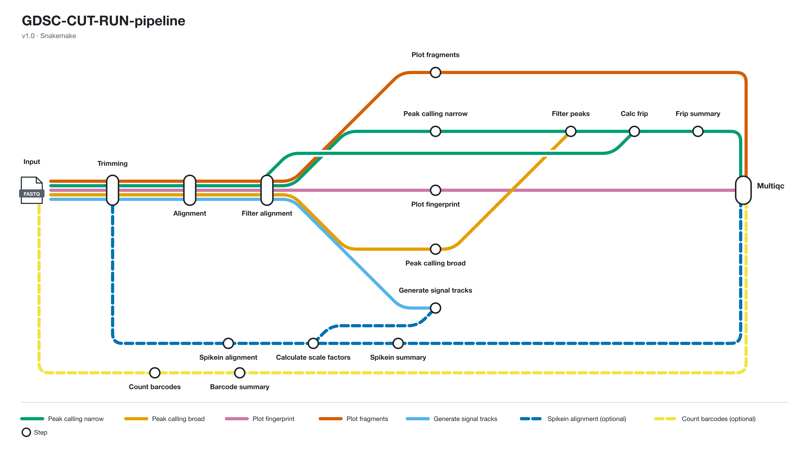

# slitherFlow 

**Subway maps for Snakemake pipelines.**


slitherFlow turns a Snakemake pipeline into a subway-map figure, in the style of the nf-core pipeline diagrams. It reads your pipeline's rule graph, writes a first draft of the map as a YAML file, and draws it as an SVG (plus PNG or PDF if you want them). You then edit the YAML until the map is to your liking.



*The GDSC miRNA-seq pipeline, drawn with slitherFlow. The first draft came from `--scan`, so every optional step is on the map.*

## Installation

Install slitherFlow with [pixi](https://pixi.sh) (a package manager for conda environments). You don't need to clone this repository:

```shell
pixi global install -c conda-forge -c bioconda --git https://github.com/mikemartinez99/slitherFlow.git --expose slitherflow
```

Pixi builds slitherFlow and installs it into its own environment, together with Python, PyYAML, Snakemake and rsvg-convert. Only the `slitherflow` command goes on your `PATH`, so you can run it from any folder. You don't need to install anything else.

slitherFlow uses the Snakemake that pixi installed. If your pipeline needs a specific Snakemake version or plugins, pass your own with `--snakemake PATH`.

### Without pixi

```shell
pip install git+https://github.com/mikemartinez99/slitherFlow.git
```

This installs the `slitherflow` command. The only Python dependency is PyYAML.

You'll also want:

- **Snakemake** on your `PATH`, so slitherFlow can read your pipeline's rule graph. You don't need it if you use `--scan` or already have a saved rule graph (see below).
- **rsvg-convert** for PNG and PDF output. On a Mac, run `brew install librsvg`. On Debian or Ubuntu, run `apt install librsvg2-bin`. SVG output works without it.

### Install from a clone, for development

To change the code or run the tests, clone the repository and let pixi set up its environment:

```shell
git clone https://github.com/mikemartinez99/slitherFlow.git
cd slitherFlow
pixi install
```

Pixi installs slitherFlow and its dependencies into a `.pixi` folder inside `slitherFlow`. Your changes to the code take effect without reinstalling.

Run slitherFlow with the `slitherflow` task. Pixi runs it in the folder you call it from, so relative paths work as usual. From any other folder, point pixi at the `slitherFlow` folder with `--manifest-path`:

```shell
cd /path/to/my-pipeline
pixi run --manifest-path /path/to/slitherFlow slitherflow auto . --png
```

The rest of this page writes commands as `slitherflow ...`. In a clone, put `pixi run` in front of them, or run `pixi shell` once to put `slitherflow` on your `PATH`. To run the tests, see [Running the tests](#running-the-tests).

## Quick start

Point slitherFlow at the folder you normally run Snakemake from:

```shell
slitherflow auto /path/to/my-pipeline --png
```

That writes three files to your current folder:

- `my-pipeline_subway.yaml`: the draft map, which you'll edit
- `my-pipeline_subway.svg`: the map
- `my-pipeline_subway.png`: the map as an image

If your pipeline needs a particular config file or profile to build its graph, put Snakemake's arguments after `--`:

```shell
slitherflow auto /path/to/my-pipeline --png -- --configfile config/test.yaml
```

### Show every optional step

Snakemake's rule graph only includes the rules your current config uses. If rRNA removal is switched off, for example, the rRNA step won't be on the map. To draw every rule no matter how the pipeline is configured, use `--scan`:

```shell
slitherflow auto /path/to/my-pipeline --png --scan
```

Instead of running Snakemake, this reads every `Snakefile` and `.smk` file in the project (hidden and `test`/`tests` folders are skipped). It works out which rules connect by matching each rule's inputs against other rules' outputs, the same way Snakemake does. It follows variables, `expand()`, f-strings, helper functions, input functions and `rules.X.output`, and anything that depends on the config is treated like a wildcard. Only rules that lead to `rule all` are kept, so helper rules for building references don't clutter the map.

A scanned map shows every path the pipeline can take, so it's usually busier than the default one. Alternative steps (say, two aligners) appear side by side, and you'll probably want to mark the optional ones with `optional: true`. The scan is a best effort: paths built from the sample sheet at run time, or rules imported with `use rule ... from`, can't always be followed. If a connection is missing, compare with `snakemake --rulegraph`, or add it yourself with `feeds`.

### Try it on the bundled example

The repo includes a saved rule graph from the GDSC miRNA-seq pipeline, so you can try slitherFlow without Snakemake or the pipeline itself. From the `slitherFlow` folder:

```shell
slitherflow auto GDSC-miRNAseq-analysis-pipeline --rulegraph examples/mirnaseq/rulegraph.dot --png
```

The result looks like this:



It's a reasonable start, but names like "Mirbase padded aln" come straight from the rule names, and there are no tools or output files yet. The next section covers how to fix that.

## Customizing your map

To customize the map, edit the YAML file and re-render it:

```shell
slitherflow render my-pipeline_subway.yaml --png --pdf
```

Running `auto` again won't overwrite your edits. It only writes a new draft if the YAML file doesn't exist yet, or if you pass `--overwrite-spec`.

The examples below take pieces of the miRNA-seq draft and improve them.

### Rename steps and add tools

Every station has a `name` and a `tool`. The tool is shown in smaller grey text under the name.

```yaml
  isomirs:
    name: "Isomir quantification"      # the name shown in the legend
    row: 1
    stations:
      - {name: "Collapse reads", tool: "seqcluster"}
      - {name: "Hairpin alignment", tool: "Bowtie"}
      - {name: "Isomir annotation", tool: "miRtop"}
```

You can rename line IDs too (`line2` → `isomirs`). Just update every place that refers to them.

### Show output files

Add `outputs` to a station to draw a file icon connected to it:

```yaml
      - name: "Isomir table"
        tool: "R"
        outputs: [{file: "TSV", label: "Isomir counts"}]
```

If an icon lands in an awkward spot, nudge it with `dx` and `dy`.

### Mark optional steps

A station with `optional: true` is drawn with a dashed circle. A line with `optional: true` is drawn dashed, and "(optional)" is added to its legend entry.

```yaml
      - {name: "PCA", tool: "R", optional: true}

  fastqc_config:
    name: "FastQC config"
    optional: true
    from: input            # starts from the raw input instead of the trunk
    row: 1.6
    stations: [{name: "Make config", tool: "Python"}]
```

### Change colours

Lines use the colour-blind-friendly Okabe-Ito palette by default. Set `color` to override it:

```yaml
  genome:
    name: "Alignment"
    color: "#0072B2"
```

### Branches

A branch splits off a station partway along another line. It uses its parent line's colour and legend entry, unless you give it its own `name` and `color`.

```yaml
  mature:
    from: {line: genome, station: "miRBase alignment"}
    row: -0.6
    stations: [{name: "Mature stats", tool: "samtools"}]
```

### Connect lines together

By default a line just stops at its last station. Use `to` to send it somewhere:

- `to: terminus`: the line runs into the end station.
- `to: {line: peaks, station: "Peak filtering"}`: the line joins a station on another line.

When a step also feeds into a station on a different line, add `feeds` to that step. This one is from the CUT&RUN draft, where the filtered alignments also go straight into the FRiP calculation:

```yaml
    - {name: "Filter alignment", tool: "", feeds: [{line: line1, station: "Calc frip"}]}
```

### The end station

The terminus is the big station at the right edge of the map, usually something like a MultiQC report. Add `file` to give it an output icon:

```yaml
terminus: {name: "MultiQC", sublabel: "QC report", row: 1, file: "HTML"}
```

### Fine-tune the layout

slitherFlow spaces stations automatically, but you can take control when you need to:

- `row` moves a whole line up or down. Negative rows are above the trunk, and fractions are fine.
- `x` pins a station to an exact horizontal position. Stations with an `x` are never moved automatically.
- `gap` adds extra space before a station, while keeping the automatic spacing.
- `label: above` or `label: below` forces the side of a station's label.

### Titles, notes and style

```yaml
title: "GDSC miRNA-seq pipeline"
subtitle: "v1.0  ·  Snakemake"
input: {label: "Input", sublabel: "Single-end", file: "FASTQ"}
footnote: "PCA runs only when there are enough samples."

style: {font: "Helvetica", line_width: 8}
```

For a complete before-and-after, compare the CUT&RUN draft ([`cutrun_draft.yaml`](examples/cutrun/cutrun_draft.yaml)) with the finished map ([`cutrun.yaml`](examples/cutrun/cutrun.yaml)).

| Draft, straight from `auto` | After editing |
|---|---|
|  |  |

## How the first draft is built

slitherFlow only looks at the shape of the rule graph. It never guesses from rule names, so it works the same way on any pipeline.

- **Trunk:** the steps every sample goes through, drawn as pill-shaped stations across several lines. It follows the longest chain from the input, and stops where the pipeline splits three or more ways.
- **Lines:** each branch after the trunk becomes its own line, alternating above and below.
- **Side lines:** steps that start from the raw input, or leave the trunk early, become dashed side lines.
- **Branches:** steps that split off partway along a line are drawn as branches. Branches leaving the same station go to the same side, so the station's label stays readable.
- **Extra connections:** any link in the rule graph that isn't already part of a line is drawn as a `feeds` connector. The exception is inputs to the end station, since drawing every QC file going into MultiQC would clutter the map.
- **End station:** the final rule that collects from the most other rules. If no final rule merges branches, the map has no end station, and each line just stops.

This works the same whether the graph came from Snakemake or from `--scan`.

Rule `all` is always skipped. If your pipeline runs MultiQC inside rule `all` (as the miRNA-seq pipeline does), MultiQC won't be in the rule graph and won't be on the draft map. You can add it back as the terminus yourself.

## Commands

| Command | What it does |
|---|---|
| `slitherflow auto PROJECT [-o map.svg] [--scan] [--png] [--pdf] [--strict]` | Writes a draft (if there isn't one yet) and renders it |
| `slitherflow draft PROJECT [-o spec.yaml] [--scan]` | Only writes the draft |
| `slitherflow render SPEC [-o map.svg] [--png] [--pdf] [--strict]` | Renders a YAML spec |

`auto` and `draft` also accept:

- `--scan` to read the Snakefiles directly instead of running Snakemake (see [Show every optional step](#show-every-optional-step))
- `--rulegraph FILE.dot` to use a saved `snakemake --rulegraph` output instead of running Snakemake
- `--save-rulegraph FILE.dot` to keep a copy of the rule graph that was used, from Snakemake or from `--scan`
- `--snakemake PATH` to use a specific Snakemake executable

slitherFlow runs `snakemake --rulegraph --nolock`, so it's safe to use while the pipeline is running. `slitherflow --version` prints the version.

Every render checks for overlapping labels, icons and lines, and prints anything it finds. With `--strict`, it exits with an error instead, which is useful in CI. The check estimates text widths, so always look at the final image too.

## Spec reference

Here's a small spec that uses most of the options. Everything except `lines` is optional.

```yaml
title: "My pipeline"
subtitle: "v1.0  ·  Snakemake"
input: {label: "Input", sublabel: "Paired-end", file: "FASTQ"}

trunk:
  stations:
    - {name: "Trimming", tool: "cutadapt"}
    - {name: "Alignment", tool: "Bowtie2", outputs: [{file: "BAM", label: "Aligned reads"}]}
  lines: [peaks, qc]           # lines that run along the trunk, top to bottom

lines:
  peaks:
    name: "Peak calling"
    color: "#009E73"
    row: -1
    to: terminus
    stations:
      - {name: "Peak calling", tool: "MACS3"}
      - {name: "Peak filtering", tool: "bedtools", outputs: [{file: "BED", label: "Filtered peaks"}]}
  qc:
    name: "Quality control"
    row: 1
    to: terminus
    stations: [{name: "Fingerprints", tool: "deepTools"}]
  spike:
    name: "Spike-in normalization"
    optional: true
    from: "Trimming"           # leaves a trunk station (or use `input`)
    row: -1.6
    to: {line: peaks, station: "Peak filtering"}
    stations: [{name: "Spike-in alignment", tool: "Bowtie2"}]
  fragments:
    from: {line: qc, station: "Fingerprints"}   # a branch
    row: 1.6
    stations: [{name: "Fragment sizes", tool: "deepTools"}]

terminus: {name: "MultiQC", sublabel: "QC report", row: 1, file: "HTML"}
footnote: "One line of explanation under the legend."
```

**Station options**

| Key | Meaning |
|---|---|
| `name`, `tool` | The label, and the smaller grey text under it |
| `optional: true` | Dashed station circle, with "optional" added to the tool text |
| `x` | Exact horizontal position |
| `gap` | Extra space before this station |
| `label: above` / `below` | Which side the label goes on. By default it goes away from the trunk (or, on a branch, away from its parent line), and moves to the other side if a line is in the way |
| `outputs` | File icons: a list of `{file, label, color, dx, dy, label_side}` |
| `feeds` | A list of `{line, station}` that this step also feeds into. The target has to be further right, on a different line |

**Other options**

- `terminus` also accepts `x` and `outputs`.
- `trunk` also accepts `labels: above`, `split_gap` (space before the lines split apart) and `branch_gap` (space before the first station after the split).
- `style` can override `spacing`, `branch_spacing`, `row_height`, `gap`, `line_width`, `corner`, `dash`, `margin` and `font`.

A few layout tips:

- A line that joins another line comes in at 45° if there's room. Give it a `row` just outside the line it joins. Where lines cross, the joining line gets a white outline so the crossing reads like a bridge.
- If branches crowd each other, spread them out with `row`, or space out their stations with `x` or `gap`.
- PNGs are rendered at 3× resolution, so they're good enough for print. The SVG and PDF are vector files, and the text in them stays editable.

## Examples

Each example folder includes the pipeline's saved rule graph, so you can rebuild any of these maps without Snakemake.

| Example | Spec | Notes |
|---|---|---|
| miRNA-seq, finished | [`mirnaseq/mirnaseq.yaml`](examples/mirnaseq/mirnaseq.yaml) | The map at the top of this page. Started from `--scan`, with optional steps dashed |
| CUT&RUN, finished | [`cutrun/cutrun.yaml`](examples/cutrun/cutrun.yaml) | The CUT&RUN draft below, after editing |
| CUT&RUN, draft | [`cutrun/cutrun_draft.yaml`](examples/cutrun/cutrun_draft.yaml) | Exactly what `draft` writes. Includes two `feeds` connectors |
| miRNA-seq, draft | [`mirnaseq/mirnaseq_draft.yaml`](examples/mirnaseq/mirnaseq_draft.yaml) | Lots of branches, and an end station that isn't MultiQC |

To rebuild the drafts:

```shell
slitherflow draft GDSC-CUT-RUN-pipeline --rulegraph examples/cutrun/rulegraph.dot -o examples/cutrun/cutrun_draft.yaml
slitherflow render examples/cutrun/cutrun_draft.yaml --png --pdf

slitherflow draft GDSC-miRNAseq-analysis-pipeline --rulegraph examples/mirnaseq/rulegraph.dot -o examples/mirnaseq/mirnaseq_draft.yaml
slitherflow render examples/mirnaseq/mirnaseq_draft.yaml --png --pdf
```

`examples/mirnaseq/rulegraph_scan.dot` is the graph `--scan` found for the miRNA-seq pipeline, which the finished map started from. Pass it to `--rulegraph` the same way to see that draft.

When you use `--rulegraph`, the project name is only used for the map's title.

## Running the tests

```shell
pixi run test
```

Without pixi, run `pip install ".[test]"` and then `pytest`. The tests don't need Snakemake or rsvg-convert. They check that:

- the example maps still render exactly as committed;
- every rule in each saved rule graph gets a station, and no connection is dropped;
- the right end station is picked;
- nothing overlaps;
- bad specs fail with a useful message;
- `--scan` follows each pattern it claims to, using the small made-up workflow in `tests/data/scan_project`.

If you change how maps are drawn on purpose, re-render the examples with the commands above, look at the new images, and commit them along with your change. The same tests run on GitHub for every push.

## How the code is organized

The code lives in the `slitherflow/` package, one file per job:

| File | What it does |
|---|---|
| `cli.py` | The `slitherflow` command: `auto`, `draft` and `render` |
| `rulegraph.py` | Runs `snakemake --rulegraph` in a project |
| `scan.py` | `--scan`: builds the rule graph by reading Snakefiles and `.smk` files |
| `draft.py` | Turns a rule graph into a starter YAML spec (trunk, lines, branches, end station) |
| `render.py` | Lays out a spec and draws it as SVG |
| `canvas.py` | SVG drawing helpers, which also record what was drawn where |
| `overlaps.py` | The overlap check |
| `style.py` | Colours, sizes and spacing |

## A note on AI

AI tools were used to help structure and write the code in this repository. All of its outputs, including every map shown here, were checked by a person before being committed. 
