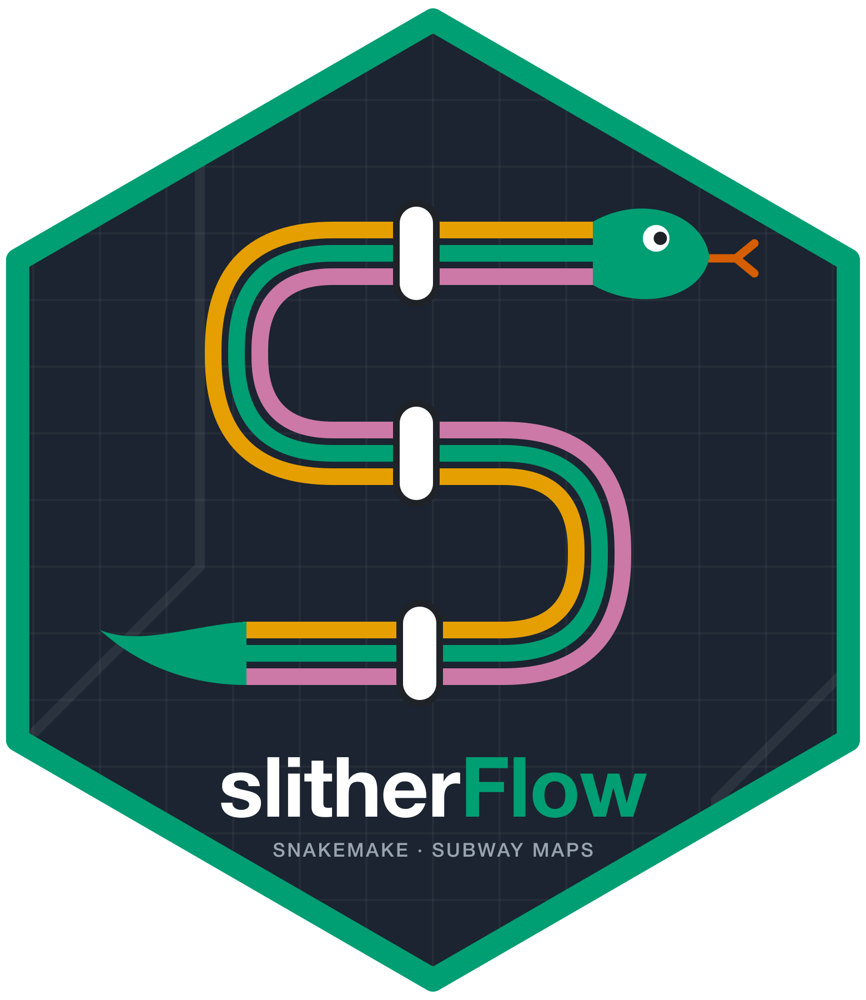
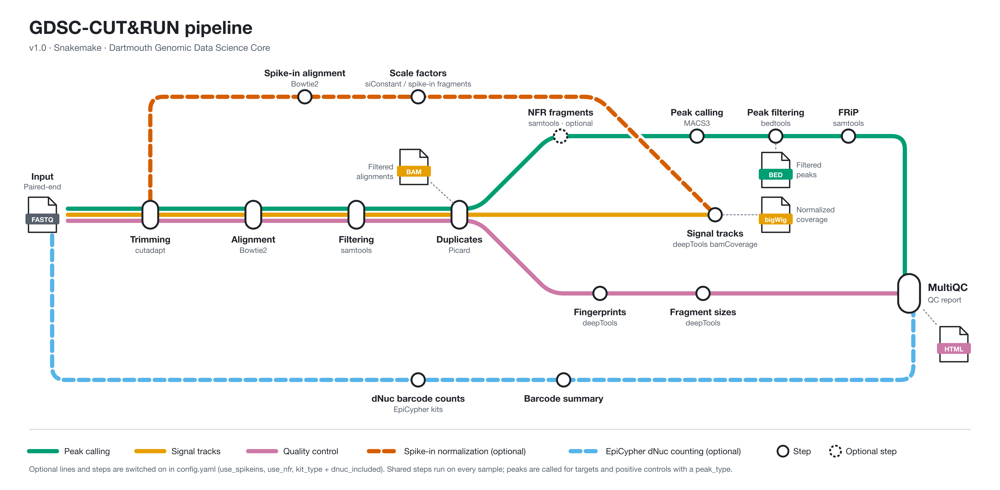

# slitherFlow 

Draw any Snakemake pipeline as an nf-core-style subway (metro) map:
- **Lines:** colour-blind-safe colours, with shared steps as pill stations on a trunk of parallel lines.
- **Branches:** 45° bends, and dashed lines and stations for optional steps.
- **Outputs and key:** file icons for outputs, plus a legend and footnote.

It works on any project where `snakemake --rulegraph` runs. It reads the rule graph, drafts a YAML spec you can edit, and renders SVG, plus PNG and PDF on request.



## Install

```shell
pip install .                       # from this folder; gives the `slitherflow` command
```

Or run the single file directly: `python3 slitherflow.py …`.

**Requirements:**
- Python ≥ 3.8 with PyYAML.
- Snakemake on your `PATH`, only for drafting from a project.
- `rsvg-convert`, only for `--png` / `--pdf` (`brew install librsvg`, or `apt install librsvg2-bin`).

## Quick start

```shell
# One step: rule graph -> starter spec -> map
slitherflow auto /path/to/project --png --pdf
#   writes <project>_subway.yaml (the spec) and <project>_subway.svg/.png/.pdf

# Edit <project>_subway.yaml (rename stations, add tools and outputs, regroup lines, mark optional steps),
# then re-render. Re-running `auto` keeps your edited spec unless you pass --overwrite-spec.
slitherflow render <project>_subway.yaml --png --pdf
```

**Projects that need a config or profile:** anything after `--` goes to Snakemake. The tool runs `snakemake --rulegraph --nolock` inside the project folder, so it doesn't interfere with a run in progress.

```shell
slitherflow auto ~/pipelines/my-rnaseq -- --configfile config/test.yaml
```

**Commands:**

| Command | What it does |
|---|---|
| `slitherflow auto PROJECT [-o map.svg] [--png] [--pdf] [--strict]` | Draft a spec (if none exists yet) and render it |
| `slitherflow draft PROJECT [-o spec.yaml]` | Only write the starter spec |
| `slitherflow render SPEC [-o map.svg] [--png] [--pdf] [--strict]` | Draw a map from a spec |

`auto` and `draft` also take:
- `--rulegraph FILE.dot`, to use a saved `snakemake --rulegraph` output instead of running Snakemake;
- `--snakemake PATH`, to pick a specific Snakemake executable.

## What the starter guesses

- **Trunk:** follows the longest chain of rules from the main input rule and stops at the first rule that fans out to three or more rules.
- **Lines:** each branch after that becomes a line, alternating above and below the trunk. Where a line splits, it follows the longest path.
- **Side lines:** branches that leave the trunk early, or rules that start from the raw input, become dashed side lines placed next to the line they join.
- **Branches:** every rule a line passed by branches off the station of its latest input, in the parent line's colour. It takes the nearest free row next to its parent, so it stays clear of lines that cover the same part of the pipeline.
- **Terminus:** the end station is chosen from the graph shape, not from rule names. It's the rule with nothing downstream (apart from `all`) that collects from the most rules, as long as it collects from at least two. Ties go to the rule with more upstream rules. If no end rule merges branches, the spec has no terminus and each line simply ends.

Rules it can't place (only possible if the rule graph has a cycle) are listed in a comment at the end of the spec. Rule names are prettified ("calc_frip" → "Calc frip"), so expect to rename stations and add tools and outputs. The [examples](#examples) show what the starter looks like before and after editing.

## Examples

Each example folder includes the pipeline's saved rule graph (`rulegraph.dot`), so you can rebuild the maps without Snakemake or the pipeline itself.

| Example | Spec | What it shows |
|---|---|---|
| CUT&RUN, finished | [`cutrun/cutrun.yaml`](examples/cutrun/cutrun.yaml) | The map at the top of this page: the draft below, after editing |
| CUT&RUN, draft | [`cutrun/cutrun_draft.yaml`](examples/cutrun/cutrun_draft.yaml) | The starter spec exactly as `draft` writes it |
| miRNA-seq, draft | [`mirnaseq/mirnaseq_draft.yaml`](examples/mirnaseq/mirnaseq_draft.yaml) | Branches leaving stations partway along a line, and a terminus that isn't MultiQC |

### CUT&RUN: draft


Every rule is placed, with no edits. The narrow and broad peak-calling lines merge at "Filter peaks". The spike-in and barcode-counting steps become dashed side lines that run to MultiQC, which is the terminus because it collects from the most rules. Compare [`cutrun_draft.yaml`](examples/cutrun/cutrun_draft.yaml) with the finished [`cutrun.yaml`](examples/cutrun/cutrun.yaml) to see the edits: renamed stations, tools and outputs, lines regrouped by purpose, and `x:` positions.

### miRNA-seq: draft


This pipeline splits again after the trunk, so most stats steps are drawn as branches. For example, "Mature mirbase stats" leaves "Mirbase padded aln", and "Mirtop stats" leaves "Mirtop". Each branch is drawn in its parent line's colour. MultiQC runs inside `rule all` here, so it isn't in the rule graph. The terminus is "Alignment metrics counts" instead: it's the only end rule that collects from more than one rule.

**To rebuild the drafts:** with `--rulegraph`, the project argument only sets the map title.

```shell
slitherflow draft GDSC-CUT-RUN-pipeline --rulegraph examples/cutrun/rulegraph.dot -o examples/cutrun/cutrun_draft.yaml
slitherflow render examples/cutrun/cutrun_draft.yaml --png --pdf

slitherflow draft GDSC-miRNAseq-analysis-pipeline --rulegraph examples/mirnaseq/rulegraph.dot -o examples/mirnaseq/mirnaseq_draft.yaml
slitherflow render examples/mirnaseq/mirnaseq_draft.yaml --png --pdf
```

## Overlap check

Every render checks for overlaps (labels against labels, file icons and lines) and prints any it finds. `--strict` exits with status 1 instead, e.g. for CI. The check estimates text widths, so treat the rendered PNG as the final word.

## Spec format

Everything except `lines` is optional.

```yaml
title: "My pipeline"
subtitle: "v1.0  ·  Snakemake"
input: {label: "Input", sublabel: "Paired-end", file: "FASTQ"}

trunk:                         # steps every sample goes through, drawn as pills across the trunk lines
  stations:
    - {name: "Trimming", tool: "cutadapt"}
    - {name: "Alignment", tool: "Bowtie2", outputs: [{file: "BAM", label: "Aligned reads"}]}
  lines: [peaks, qc]           # lines that run along the trunk (stacked by row automatically)

lines:
  peaks:
    name: "Peak calling"       # legend text
    color: "#009E73"           # optional; defaults to the Okabe-Ito palette in order
    row: -1                    # rows from the trunk: negative = above, 0 = straight on, fractions are fine
    to: terminus               # terminus | none | {line: <id>, station: <name>}
    stations:
      - {name: "Peak calling", tool: "MACS3"}
      - {name: "Peak filtering", tool: "bedtools", outputs: [{file: "BED", label: "Filtered peaks"}]}
  qc:
    name: "Quality control"
    row: 1
    to: terminus
    stations: [{name: "Fingerprints", tool: "deepTools"}]
  spike:
    name: "Spike-in normalization"
    optional: true             # dashed line ("(optional)" is added to the legend)
    from: "Trimming"           # side line: leaves a trunk station, or `input`
    row: -1.6
    to: {line: peaks, station: "Peak filtering"}
    stations: [{name: "Spike-in alignment", tool: "Bowtie2"}]
  fragments:                   # branch: leaves a station on another line, at 45 degrees
    from: {line: qc, station: "Fingerprints"}
    row: 1.6
    stations: [{name: "Fragment sizes", tool: "deepTools"}]

terminus: {name: "MultiQC", sublabel: "QC report", row: 1, file: "HTML"}
footnote: "One line of explanation under the legend."
```

**Per-station options:**

| Key | Meaning |
|---|---|
| `name`, `tool` | Station label and the smaller grey line under it |
| `optional: true` | Dashed station circle; adds "optional" to the tool line |
| `x` | Absolute x position (the main way to fine-tune a layout) |
| `gap` | Extra space before this station, keeping automatic spacing |
| `label: above` / `below` | Force the label side. By default it goes above for stations above the trunk and below otherwise, and flips when a line leaves or arrives on that side |
| `outputs` | List of `{file, label, color, dx, dy, label_side}`: a file icon joined to the station by a dotted line. It sits opposite the label (or right of a line's last station), and `dx`/`dy` move it relative to the station |

**Branches:** a line with `from: {line: <id>, station: <name>}` leaves that station. Unless you set them, it takes its parent's `color`, legend `name` and dashing, so it shares the parent's legend entry. Give it its own `name` and `color` to list it separately.

**Automatic spacing:** stations without `x` are spaced so their labels don't touch. A station that another line joins (`to: {line, station}`) is pushed right if the joining line would otherwise reach it from behind. Stations with an explicit `x` are never moved.

**Other keys:**
- `terminus` also takes `x` and `outputs`.
- `trunk` also takes `labels: above`, `split_gap` (space after the last trunk station before branches split) and `branch_gap` (space after the bends before the first branch station).
- `style` overrides the layout constants: `spacing`, `branch_spacing`, `row_height`, `gap`, `line_width`, `corner`, `dash`, `margin`, `font`.

## Layout tips

- **Side lines:** a line that joins another line's station drops in at 45° if there's room, and otherwise runs along and drops in vertically. Give it a `row` just outside the line it joins. It's drawn with a white casing so its crossings read as bridges.
- **Crowded branches:** if two branches crowd each other, spread them out with `row`, or space their stations with `x` / `gap`.
- **Print quality:** the PNG is rendered at 3× for print. The PDF and SVG are vector and keep text editable.
